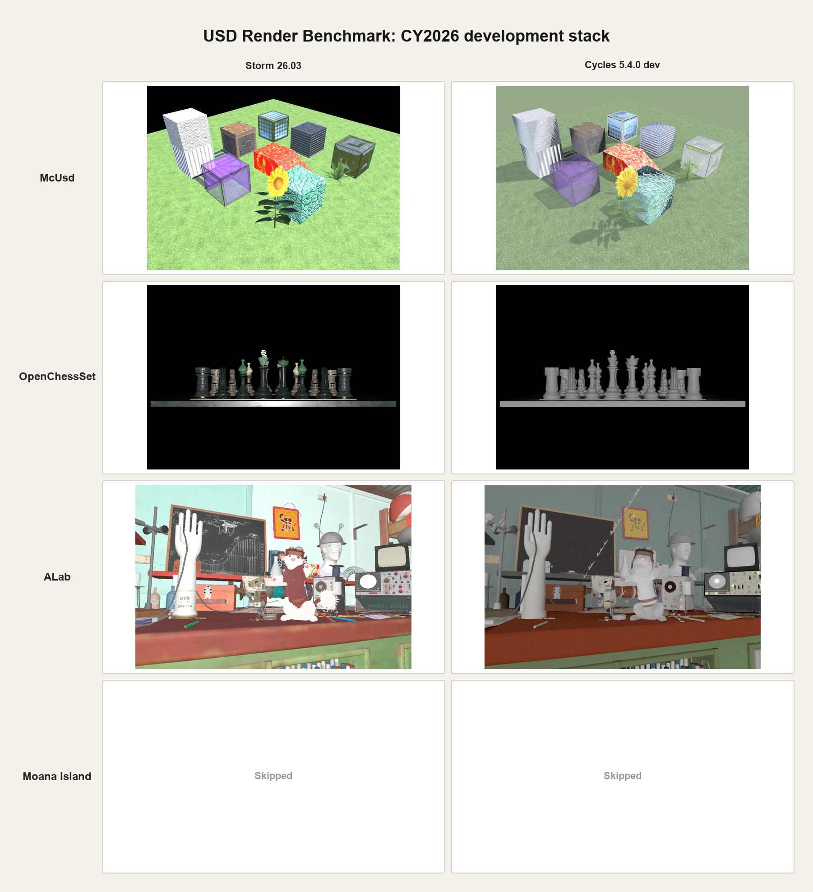

# ASWF CY2027 / Hydra Render Benchmark

This branch records a partial Storm and Cycles
benchmark using the ASWF CY2027 environment and OpenUSD 26.08.
It is not a complete CY2027 rerun of the original benchmark.

## Run configuration

- Renderers: Storm, Cycles 5.4.0 dev
- OpenUSD: 26.08
- Container: `ghcr.io/nicolaspopravka/usd-render-benchmark@sha256:169bb3300d3c0ebe8bb383018c01346ebfddddc2baa3ba4fcc2a5970c2ce0223`
- GPU: NVIDIA RTX PRO 6000 Blackwell Server Edition, 96 GB
- Driver: NVIDIA 595.91.07
- OS: Rocky Linux 9.8

## Results

The results are in [`render_summary.md`](render_summary.md). Rendered images are under [`renderers/`](renderers/). Complete logs are under [`logs/`](logs/).
