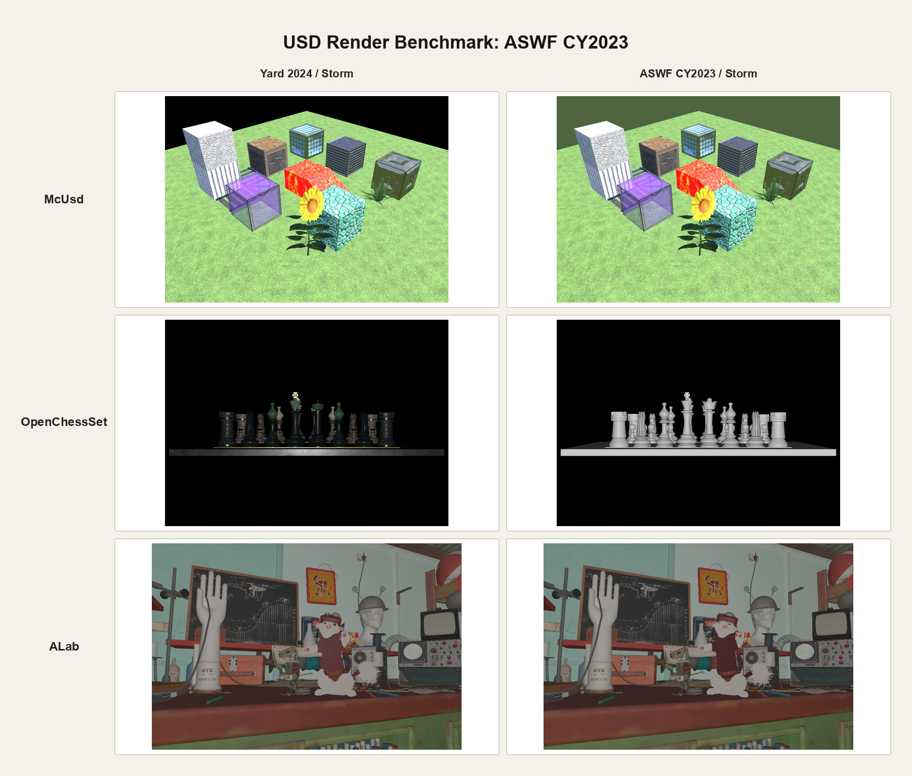

# ASWF CY2026 / Storm Render Benchmark

This branch records a partial Storm run using the ASWF CY2026
environment and OpenUSD 26.03. It is not a complete CY2026 rerun of the original benchmark.

## Run configuration

- Renderers: Storm
- OpenUSD: 26.03
- Container: `ghcr.io/nicolaspopravka/usd-render-benchmark@sha256:7257aa81865b3d17d5f6a8ff64d9a376c7de5a44fdbdf8538e48a82aa397f6c0`
- GPU: NVIDIA RTX 2000 Ada Generation, 16 GB
- Driver: NVIDIA 570.172.08
- OS: Rocky Linux 8.10

## Results

The results are in [`render_summary.md`](render_summary.md). Rendered images are under [`renderers/Storm/`](renderers/Storm/). Complete logs are under [`logs/`](logs/).
